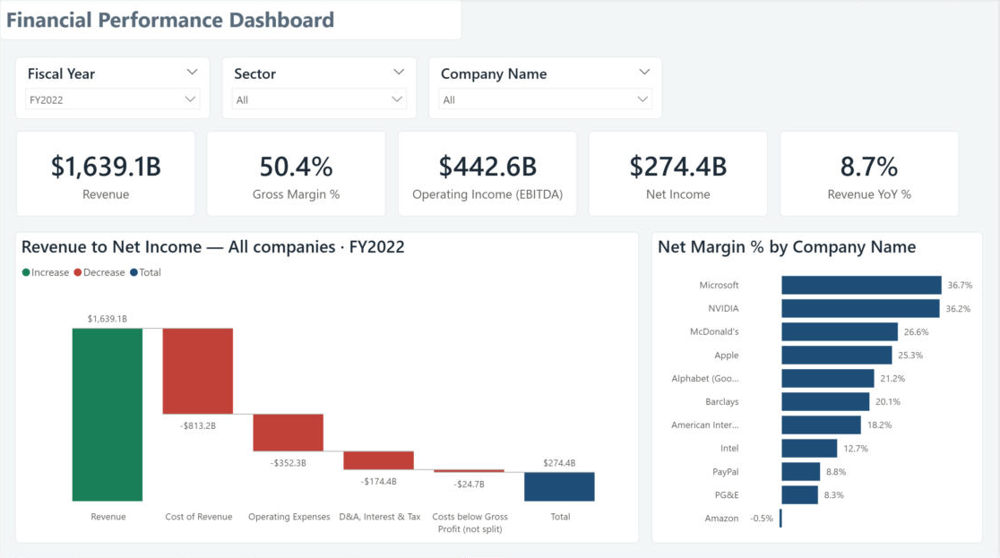
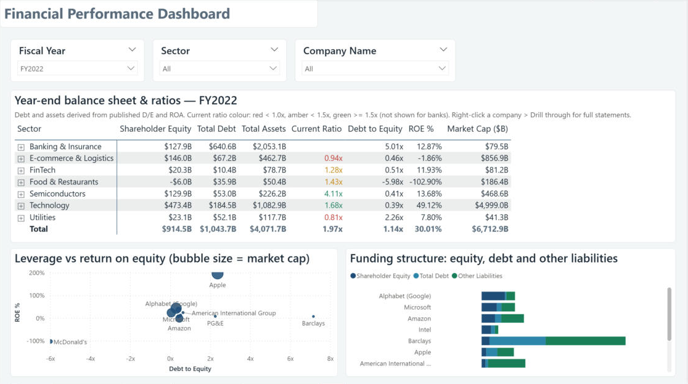
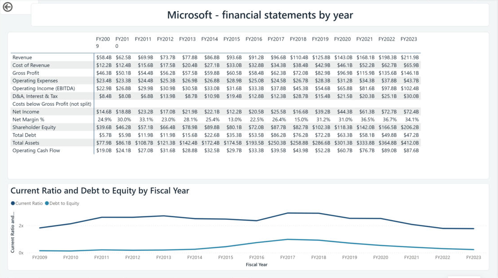
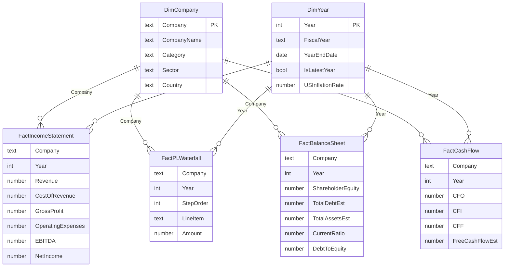

# Financial Performance Dashboard (Power BI)

**Replacing a manual Excel month-end reporting pack with a refreshable, three-page Power BI dashboard.**


---

## The problem

Finance teams still build monthly leadership reports in Excel: refresh pivot tables by hand, copy numbers between tabs, export a static PDF, repeat next month. It is slow and error-prone, and it can't answer the follow-up question *"why did margin drop?"* without another round of spreadsheet work.

## The solution

A Power BI model that takes the raw financial statements file, shapes it automatically in Power Query, calculates every KPI with DAX, and serves it as an interactive report. Next period: drop in the new file → **Refresh**.

| Manual Excel process | This dashboard |
|---|---|
| Copy/paste raw exports into tabs | Power Query reads the source files directly |
| Re-point pivot ranges every month | Star schema; refresh picks up new rows |
| Ratios in fragile cell formulas | 45+ documented, reusable DAX measures |
| Static PDF to leadership | Interactive report + scheduled refresh + email subscription |
| "Can you break that down by company?" = another day | Drill-through to company statements in one click |

---

## Dashboard pages

| # | Page | What it shows |
|---|---|---|
| 1 | **P&L Overview** | KPI cards (Revenue, Gross Margin, Operating Income, Net Income, like-for-like growth) and a **waterfall** bridging Revenue → Net Income |
| 2 | **Trends** | **Combo chart** of revenue & operating income (columns) vs net margin (line); simple vs like-for-like YoY growth; cash flow by activity; gross-margin small multiples |
| 3 | **Balance Sheet & Ratios** | Matrix by Category → Company with equity, debt, assets, **current ratio** (RAG-colored), D/E, ROE; leverage-vs-return scatter |
| ↳ | **Company Detail** *(drill-through)* | Full statement view (line items × years), company waterfall, liquidity trend |

<!-- Add screenshots after building: docs/screenshots/01-pl-overview.png etc. -->
| P&L Overview | Trends |
|---|---|
|  |  |
| **Balance Sheet & Ratios** | **Company Detail (drill-through)** |
|  |  |

---

## Data model



**Power Query pipeline:** three source files (raw statements CSV + `company_master.csv` + `pl_waterfall_steps.csv`) → one staging query (header fixes, typing, % rescaling, de-dup) → two dimensions and four fact tables. All file paths come from parameters, so moving the project or swapping in a new period is a one-field change.

---

## Key DAX measures

Full list with comments: [`dax/measures.dax`](dax/measures.dax)

| Measure | Logic |
|---|---|
| Gross Margin % | `DIVIDE([Gross Profit], [Revenue])` |
| Operating Income (EBITDA) | `SUM(FactIncomeStatement[EBITDA])`, the dataset's operating-income line |
| Revenue YoY % | Current year vs `CALCULATE([Revenue], REMOVEFILTERS(DimYear), DimYear[Year] = _Year - 1)` |
| Revenue YoY % (LFL) | Same, but only for companies reporting in **both** years (`SUMX` over comparable companies). Removes growth that is really just a company joining the dataset |
| Revenue CAGR % | `(Last / First) ^ (1 / years) - 1` over the years in context |
| Current Ratio | `LASTNONBLANKVALUE(DimYear[Year], AVERAGE(...))`, semi-additive, so it never sums across years |
| Debt to Equity | Weighted: total debt ÷ total equity (not an average of ratios) |
| Shareholder Equity / Total Assets | `LASTNONBLANKVALUE`: closing balance, correct in any total row |
| Waterfall Amount | `SUM(FactPLWaterfall[Amount])`, with signed steps from the reference file |

```dax
Revenue YoY % (LFL) =
VAR _Comparable =
    FILTER ( VALUES ( DimCompany[Company] ),
             NOT ISBLANK ( [Revenue] ) && NOT ISBLANK ( [Revenue PY] ) )
VAR _Cur  = SUMX ( _Comparable, [Revenue] )
VAR _Prev = SUMX ( _Comparable, [Revenue PY] )
RETURN DIVIDE ( _Cur - _Prev, _Prev )
```

---

## Repo structure

```
├── data/
│   ├── raw/                  # Kaggle CSV goes here (git-ignored)
│   ├── sample/               # synthetic sample, same schema, so the repo runs out of the box
│   └── reference/            # company master + P&L bridge definition
├── powerquery/               # 00–07 M queries, paste in order
├── dax/measures.dax          # all measures, loadable via DAX query view
├── theme/finance-theme.json  # report theme
├── scripts/
│   ├── make_sample_data.py   # regenerates the synthetic sample
│   └── reconcile.py          # independent pandas re-calc to tie out dashboard numbers
├── report/                   # .pbip / .pbix lives here
└── docs/
    ├── build-guide.md        # step-by-step build instructions
    ├── data-dictionary.md    # columns, derivations, limitations
    └── screenshots/
```

## How to run it

1. Clone the repo and download the dataset into `data/raw/` ([instructions](data/README.md)), or skip this and use the bundled sample.
2. Follow [`docs/build-guide.md`](docs/build-guide.md): parameters → paste M queries → relationships → load DAX → build pages.
3. Tie out the numbers:
   ```bash
   pip install pandas numpy
   python scripts/reconcile.py "data/raw/Financial Statements.csv"
   ```
   The output matches the `EVALUATE` query at the bottom of `measures.dax`. It also checks that the P&L bridge sums to net income.

## Assumptions and limitations

The dataset is **annual, company-level** and publishes ratios rather than full balance sheets. So:
- **EBITDA** is used as operating income (named that way so it isn't confused with EBIT).
- **Total debt and total assets are estimated** from published D/E and ROA, and are labeled *(est.)* everywhere.
- Drill-through goes **Category → Company → statement lines**. The model is ready for a `DimDepartment` if department-level data is available.

Details: [`docs/data-dictionary.md`](docs/data-dictionary.md).

## Skills demonstrated

Power Query (parameterized multi-file ingestion, unpivoting, reference-table joins, error handling) · star-schema modeling · DAX time intelligence without a date table · semi-additive measures · like-for-like growth · waterfall / combo / matrix / small-multiples visuals · drill-through · conditional formatting by measure · themes · data reconciliation.

---

*Dataset: [Financial Statements, Kaggle (rish1203)](https://www.kaggle.com/datasets/rish1203/financial-statements). Sample data in `data/sample/` is synthetic and does not represent any real company.*
